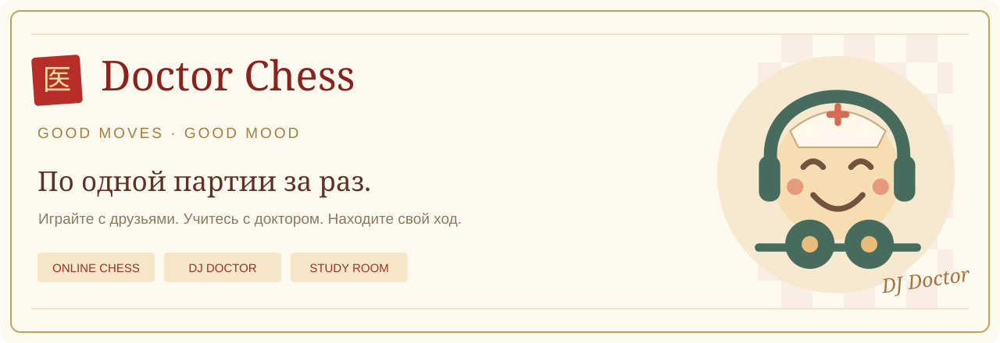

<b>Шахматы на хорошей волне.</b> Играйте с друзьями, находите соперников и разбирайте партии вместе с DJ Doctor.

<a href="https://doctor-chess.ru"><b>Играть в Doctor Chess ↗</b></a> · <a href="https://doctor-chess.ru/academy">Школа Доктора</a> · <a href="https://github.com/ubica1/doctor-chess/issues">Обратная связь</a>

  

**Doctor Chess** — шахматный веб-клуб. Красно-белая доска в золотой раме, китайские орнаменты и маленький доктор в наушниках создают атмосферу, в которой хочется сыграть ещё одну партию.

Играйте в браузере на компьютере, планшете или телефоне. Для партий с людьми нужен профиль; тренировка с доктором доступна без регистрации.

## За одной доской

**Случайный соперник.** На главной видно число игроков в сети и ожидающих по каждому контролю. Выберите ритм и начните поиск. Каждая партия открывается в своей игровой комнате: доска, часы, запись ходов и действия игроков находятся рядом. Обновление страницы восстанавливает сетевую партию; выход из комнаты не останавливает часы.

**Партия с другом.** Создайте приглашение, выберите цвет и контроль, отправьте ссылку. Друг входит в свой профиль и присоединяется к вам. Приглашение действует 30 минут. Из профиля можно вызвать конкретного игрока — принять такой вызов сможет только он. Дружеская встреча не меняет рейтинг; после окончания можно предложить реванш со сменой цветов. Пока соперник ещё не ответил, можно попросить вернуть свой последний ход. Возврат требует его согласия, а потраченное время не возвращается. Кнопка «+15 сек сопернику» позволяет подарить время — до пяти минут за партию.

**Домашняя партия.** Играйте вдвоём на одном устройстве без часов и рейтинга. Фигуры можно перемещать касанием, кликами или перетаскиванием.

Каменные звуки ходов и взятий включены по умолчанию. Кнопка с нотой запоминает ваш выбор в браузере.

Полоса связи показывает ваше подключение и присутствие соперника. При возврате во вкладку приложение запрашивает актуальную позицию, а после сбоя восстанавливает соединение. Часы партии продолжают идти; потеря связи сама по себе не объявляет поражение.

## У доски есть зрители

В [зрительном зале](https://doctor-chess.ru/watch) можно смотреть текущие рейтинговые партии, открытые обоими игроками, и выбирать контроль времени. Дружеская трансляция доступна по ссылке. Смотреть можно без регистрации.

В игровой комнате откройте «Зрители у вашей доски»: оба участника должны разрешить просмотр. Любой из них может закрыть трансляцию. Зритель видит доску, часы, профили и ходы; можно вернуться к ранней позиции, перевернуть доску, рисовать свои стрелки и снова перейти к прямому эфиру. Просмотр записи не останавливает партию. После окончания видны результат и причина, становится доступен разбор.

## Ваш шахматный профиль

Публичная страница объединяет эмблему, описание, статистику и историю завершённых сетевых партий. У каждого контроля свой рейтинг:

| Рейтинг  | Контроли      |
| -------- | ------------- |
| Пуля     | 1+0           |
| Блиц     | 3+0, 3+2, 5+0 |
| Рапид    | 10+0, 15+10   |
| Классика | 30+0          |

Стартовый рейтинг — 1200. Elo меняют только завершённые рейтинговые партии. Тренировки и дружеские встречи на него не влияют.

## На приёме у DJ Doctor

Доктор играет на основе **Stockfish 19 Lite** и авторского дебютного репертуара из книги DJ Doctor «Атака Доктора и Защита Доктора». Три уровня силы, выбор цвета, подсказки и возможность продолжить игру из выбранной позиции помогают найти подходящий темп тренировки.

В [Школе Доктора](https://doctor-chess.ru/academy) — 15 дебютных вариантов, репетиция ходов за обе стороны, задачи с объяснениями и повторение изученного материала. Прогресс обучения сохраняется на вашем устройстве.

В [задаче дня](https://doctor-chess.ru/daily) нужно поставить мат в один или два хода. Новая позиция появляется в полночь по Москве. Самостоятельные решения идут в серию, которая хранится в браузере.

Во вкладке [«Задачи»](https://doctor-chess.ru/puzzles) есть 960 позиций из открытой базы Lichess. Выберите тему и один из трёх уровней сложности. С профилем у вас есть отдельный рейтинг задач со стартом 1200. Рейтинг меняется по результату первой попытки, а незаконченная задача сохраняется. Гости решают задачи без рейтинга.

Доска отмечает верные и неверные ходы. Сыгранную линию можно пересматривать по стрелкам или нажимать на ход в записи. После завершения задачи доступна оценка Stockfish для выбранной позиции.

## Партия продолжается в разборе

- Просматривайте запись ходов и переходите к любой позиции.
- Открывайте отдельный вариант и возвращайтесь к исходной партии.
- Получайте оценку Stockfish, лучший ход и продолжение.
- Находите неточности, ошибки и зевки в разборе всей партии.
- Переносите партии через PGN, а позиции — через FEN.
- Сохраняйте PGN с оценками для дальнейшего изучения.

Подсказки отключены во время сетевой партии. Оценки быстрого разбора ориентировочные; уровни Доктора не являются измеренным человеческим Elo. Обычный импорт партии читает основную линию PGN. Для работы с комментариями и вложенными вариантами используйте тетрадь в Мастерской.

## Мастерская шахматных идей

[Мои исследования](https://doctor-chess.ru/studies) · [Редактор позиций](https://doctor-chess.ru/editor) · [Повторение ошибок](https://doctor-chess.ru/practice)

**Тетради с вариантами.** Начните с начальной позиции, FEN или своей партии. Добавляйте ответвления прямо на доске, записывайте мысли к каждому ходу, ставьте знаки оценки и выбирайте главную линию. Импорт и экспорт PGN сохраняют вложенные варианты, комментарии и шахматные обозначения. В тетради помещаются до 400 позиций; одна линия — до 200 полуходов.

Сохранённые тетради связаны с профилем и доступны с другого устройства. Новая тетрадь видна только автору. Доступ по ссылке включается отдельно: читатель может изучать и экспортировать запись, а изменять её — только автор. Черновик восстанавливается на устройстве; одновременное сохранение из разных вкладок не перезаписывает чужие правки молча. Ненужную тетрадь можно убрать в архив и вернуть обратно. В профиле — до 100 тетрадей, включая архив.

**Своя позиция.** Расставляйте фигуры, выбирайте сторону хода, права рокировки и взятие на проходе. Редактор проверяет позицию, позволяет скопировать FEN, открыть исследование или сыграть её с Доктором.

**Работа над ошибками.** Сохраните отмеченные ходы из разбора в личную очередь повторения. Восстановите рекомендацию анализа на доске, затем вернитесь к ней через 1, 3, 7 и 14 дней. Подсказанная попытка не считается самостоятельным решением. Это тренировка рекомендаций из конкретного разбора: другие хорошие ходы также могут существовать. Очередь до 100 позиций хранится на текущем устройстве отдельно для каждого профиля.

## Рисуйте мысли на доске

Правая кнопка мыши ставит круг; потяните от клетки к клетке, чтобы нарисовать стрелку. Зелёные, красные, золотые и синие отметки помогают показать угрозу, маршрут фигуры или ключевое поле. Повторная отметка убирает её; есть отмена и очистка. На телефоне откройте «Пометки на доске», включите «Рисовать» и выберите две клетки касаниями. Пока включено рисование, фигуры не ходят.

В партии пометки видны только вам и очищаются после хода. В своей тетради они сохраняются у выбранной позиции вместе с вариантами и комментариями. Импорт и экспорт PGN понимают стрелки и круги в обозначениях `[%cal]` / `[%csl]`. Читатели тетради видят сохранённые пометки. Кнопка «Скачать диаграмму» сохраняет SVG с текущей расстановкой, цветом хода, ориентацией доски и вашими отметками.

## Ваши партии и данные

Сетевые партии, рейтинги и сохранённые тетради связаны с профилем. Домашняя библиотека, настройки и учебный прогресс хранятся в браузере на конкретном устройстве. В библиотеке — до 40 домашних записей; важные партии можно скачать в PGN. Очистка данных браузера удаляет записи и прогресс, сохранённые на устройстве.

Подробнее: [данные и безопасность](SECURITY.md).

## Репозиторий и лицензии

Исходный код Doctor Chess доступен на [GitHub](https://github.com/ubica1/doctor-chess). Условия использования кода описаны в [лицензии](LICENSE). Замечания и предложения принимаются в [Issues](https://github.com/ubica1/doctor-chess/issues); изменения — через pull request.

Stockfish распространяется с собственной лицензией, указанием авторов, соответствующими исходниками и нейросетью. [Сторонние компоненты](NOTICE.md) · [Stockfish](doctor-chess-site/dist/vendor/stockfish/README.md).

[Участие](CONTRIBUTING.md) · [Архитектура](docs/ARCHITECTURE.md) · [API](docs/API.md) · [Руководство по тренировкам](docs/DOCTOR.md) · [Релизы](https://github.com/ubica1/doctor-chess/releases) · [История версий](CHANGELOG.md) · [Ревью качества](docs/REVIEW-2026-11-06.md)

棋友 · По одной партии за раз.

