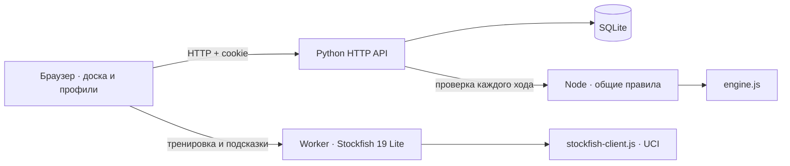

# Архитектура

Doctor Chess — локальное веб-приложение без сборки клиентского кода. В runtime достаточно стандартной библиотеки Python и Node.js. Prettier и Black нужны только разработчикам.

## Границы ответственности

| Модуль                           | Ответственность                                                                                                                   |
| -------------------------------- | --------------------------------------------------------------------------------------------------------------------------------- |
| `server.py`                      | Сессии, аккаунты, рейтинги, часы, очередь, маршруты и статические файлы.                                                          |
| `social.py`                      | Приглашения, сроки, доступ участников, создание сетевых игр и реванши.                                                            |
| `engine.js`                      | Допустимые ходы, шах, рокировка, превращение, взятие на проходе и базовые завершения партии. Один модуль в браузере и на сервере. |
| `engine-runner.cjs`              | Принимает JSON через stdin, проверяет один ход, возвращает JSON через stdout. Вызов без shell-интерполяции.                       |
| `board-view.js`                  | Постоянные DOM-элементы фигур, анимация перемещения, Pointer Events, отмена перетаскивания.                                       |
| `app.js`                         | Открытый режим, текущая партия, серверная синхронизация и локальный отклик.                                                       |
| `premoves.js`                    | Один ожидающий ответ. Повторная проверка после подтверждённого хода соперника.                                                    |
| `club.js`                        | Экран приглашения, ожидание друга, реванш и действия с ничьей.                                                                    |
| `studio.js` / `workbench.js`     | Тренировка, библиотека, просмотр истории, импорт и отдельная линия анализа.                                                       |
| `notation.js`                    | SAN, FEN, PGN и восстановление записи из позиций.                                                                                 |
| `search.js` / `doctor-worker.js` | Ограниченный учебный поиск вне основного потока интерфейса.                                                                       |

## Сетевая партия

1. Игрок входит в сессию с HttpOnly cookie.
2. Очередь или принятое приглашение создаёт серверную игру.
3. Пользователь делает ход; интерфейс показывает его сразу.
4. Сервер проверяет участника, очередь хода и время, затем передаёт ход общим правилам.
5. Принятый ход сохраняется в SQLite. Если сервер отклоняет ход, клиент откатывает локальное отображение.
6. Второй игрок получает новое состояние при опросе `/api/state`.

На сервере применяется общий `RLock`. Принятие приглашения и завершение игры используют SQLite-транзакции. Повторное принятие участником возвращает ту же игру; третий игрок не создаёт дубликат. Завершение рейтинговой партии обновляет Elo один раз. `kind=casual` сохраняет результат без пересчёта рейтинга.

## Открытый режим и фоновая партия

Открытая домашняя доска отделена от `remoteGame`. Поздний ответ сервера не должен возвращать пользователя в другой режим. Счётчик `networkEpoch` отбрасывает ответы, полученные после нового действия пользователя. При уходе из активной сетевой игры её часы продолжаются; появляется кнопка возврата.

У учебного Worker свой счётчик поколения. При смене режима, отмене или новой тренировке старый Worker завершается, а поздний результат не применяется к другой позиции.

## Хранение

SQLite содержит `users`, `sessions`, `ratings`, `games`, `queue`, `challenges`. Изменения схемы добавляют недостающие столбцы, не очищая имеющиеся аккаунты и партии.

- Сессии хранят SHA-256 от случайного токена; cookie содержит сам токен.
- Пароли: PBKDF2-SHA256, 310 000 итераций и уникальная соль.
- Библиотека тренировок: `localStorage` конкретного браузера.
- Позиция вкладки и исходная запись варианта: `sessionStorage`.
- Рабочая база и временные файлы исключены из Git.

## Условия завершения и ограничения

Реализованы мат, пат, правило 50 ходов, трёхкратное повторение и основные случаи недостаточного материала, включая только одноцветных слонов. Это учебная реализация: полный набор турнирных исключений и сложные случаи невозможности мата ещё требуют расширения.

Синхронизация пока использует HTTP-опрос раз в секунду. Сервер рассчитан на localhost и небольшую нагрузку. Публичный хостинг, WebSocket, горизонтальное масштабирование не входят в текущую версию. Stockfish 19 Lite работает локально в браузерном Worker через отдельный UCI-адаптер.

Импорт PGN читает одну основную линию. Комментарии и вложенные варианты пропускаются. Анализ на доске — отдельная рабочая линия с сохранённым исходником.

## Проверки

`npm test` последовательно запускает тесты правил, разбора, клиентских переходов и настоящего HTTP-сервера на временной базе. Тестовые аккаунты не попадают в пользовательскую базу. См. также [CONTRIBUTING](../CONTRIBUTING.md).

## Stockfish, авторский репертуар и школа

`doctor-book.js` компилирует 15 проверяемых SAN-линий в 101 позицию. Поиск книжного хода использует FEN без счётчиков. Вне книги первые ходы ограничиваются доступными построениями Доктора; шахи, взятия и немедленные угрозы имеют приоритет. Другой дебютной книги нет.

`stockfish-client.js` владеет одним Worker и обменивается только UCI-строками. Он передаёт исходный FEN и историю ходов, обрабатывает `uciok`, `readyok`, `info`, `bestmove`, проверяет таймауты и завершает Worker при отмене. Ответ проходит обычную проверку легальности. При отказе WASM бот использует явно обозначенный резервный поиск с теми же ограничениями начального построения.

Бот, подсказки и полный разбор имеют независимые поколения запросов. Старый ответ не вправе завершить новый Worker. Разбор использует неизменяемый снимок линии; смена игры или режима отменяет его. Активная сетевая партия блокирует подсказки и разбор.

`outcome.js` даёт общую модель результата для сети, тренировки и импорта. Сетевая доска ждёт `game.result` от сервера: оптимистический мат не объявляет победу. `ratingChange` фиксируется в payload партии в одной транзакции с обновлением Elo, поэтому повторный опрос не пересчитывает и не подменяет старый итог.

`academy.js` ведёт отдельную доску, не меняя текущую партию. Прогресс задач хранится в `dc-academy`. Просмотр готового ответа не засчитывает решение. При уходе со страницы учебная доска освобождает обработчик окна.
